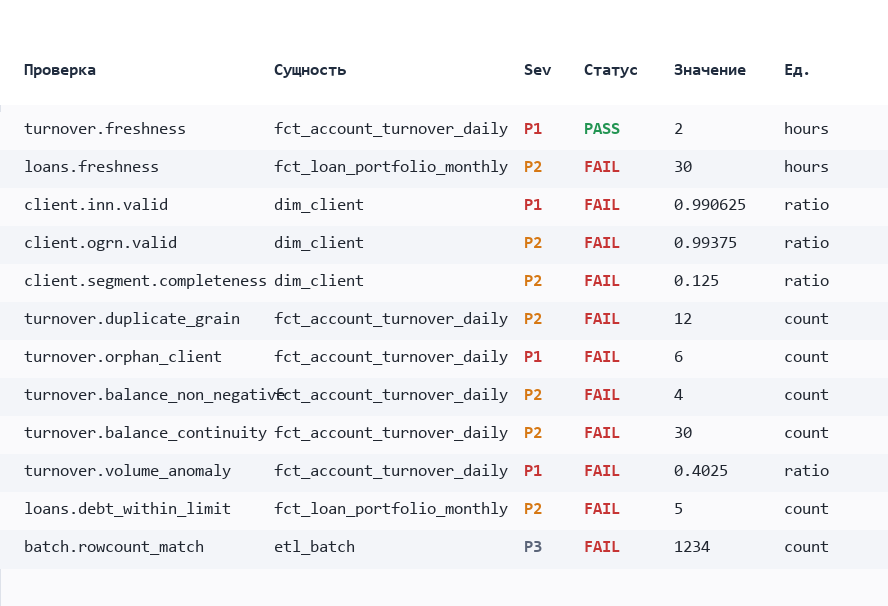
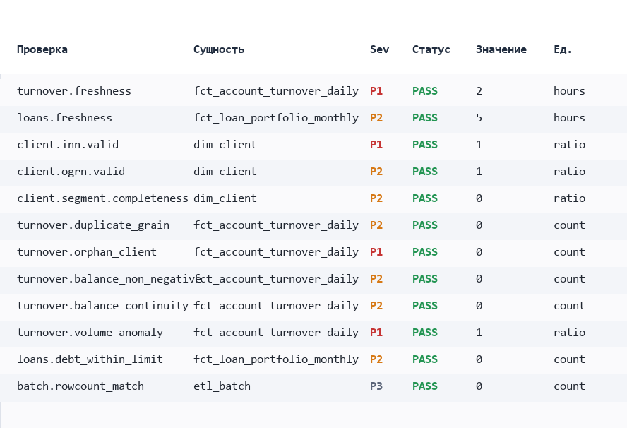
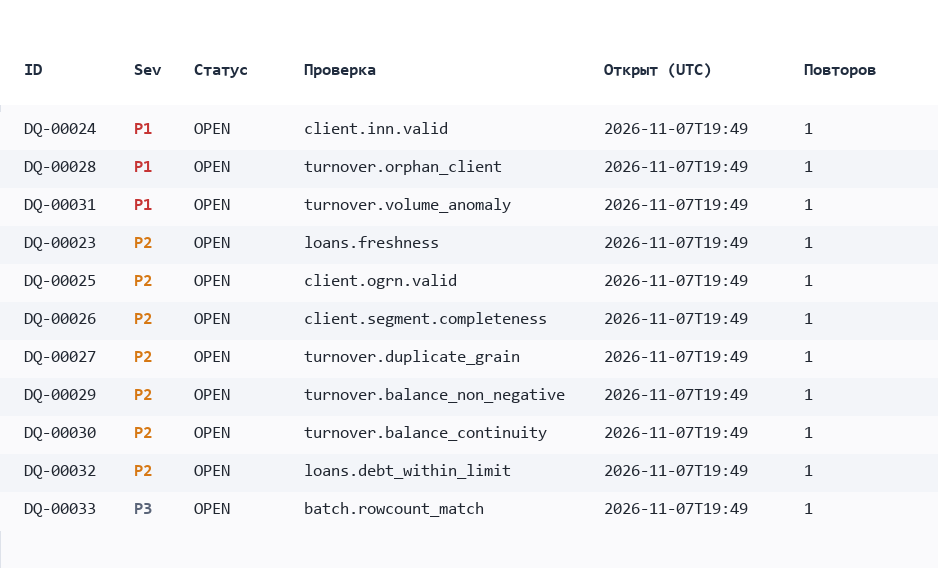
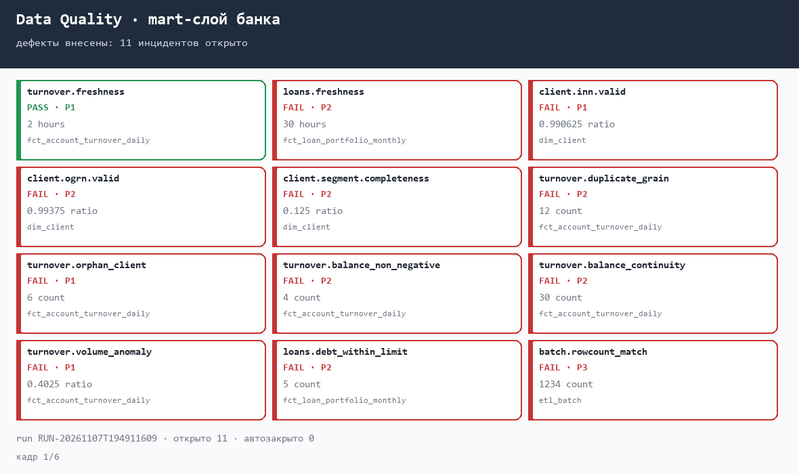
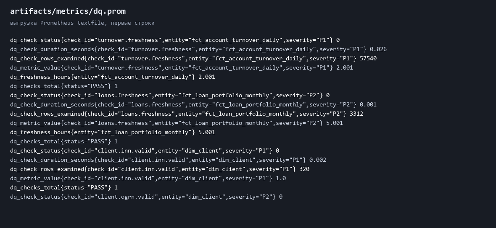

# data-reliability-dq

## Простыми словами

Аналитическое хранилище банка каждую ночь наполняется данными из нескольких
систем. Если загрузка пришла не целиком, задвоилась или опоздала, отчёты и
дашборды показывают неверные цифры — и обычно об этом узнают через неделю от
аналитика, а не от мониторинга.

Этот проект — контрольный контур такого хранилища. Он раз в полчаса прогоняет
12 проверок («данные свежие? дубликатов нет? остатки сходятся? объём не просел?»)
и ведёт журнал инцидентов: что сломалось, насколько это критично, кто взял в
работу и за сколько починили.

**Где применяется**

- в команде сопровождения хранилища (DWH / Data Quality) — ночные и получасовые
  проверки витрин;
- на дежурстве — приоритеты P1–P3, SLA реакции и MTTR вместо переписки в чате;
- в релизном процессе — прогон проверок на тестовой партиции до выкатки
  изменений в витрины;
- в аналитике — прежде чем строить отчёт на новой витрине, видно, можно ли ей
  доверять.

**Как это используется**

1. Ночью Airflow загружает данные в mart-слой и пишет в `ops.etl_batch`, что и
   когда приехало.
2. Каждые 30 минут запускается каталог проверок: свежесть, дубликаты
   гранулярности, сироты по справочнику, отрицательные остатки, разрывы остатка,
   аномалии объёма, сверка rowcount.
3. Упавшая проверка открывает инцидент с приоритетом и прикладывает 5 строк
   нарушения; повторные падения не плодят тикеты, а увеличивают счётчик.
4. После перезаливки данных проверка зеленеет — инцидент закрывается сам, в
   отчёте обновляется MTTR.
5. Отчёт читают люди, метрики забирает Prometheus/Grafana.

## Что это технически

Пет-проект под роль **Data Reliability Engineer / Аналитик по сопровождению данных**:
контур контроля качества и доступности аналитического хранилища по ключевым клиентам
банка (юрлица) — DQ-проверки на SQL, раннер на Python, инциденты, метрики и экспорт
в Prometheus, Airflow-обвязка, CI.

Проект запускается одной командой на чистой машине: демо-хранилище поднимается в
SQLite, продакшн-SQL лежит отдельно в `sql/greenplum/` и написан под Greenplum
(PostgreSQL, MPP).

```bash
python run.py demo
```

```
ШАГ 1. Собираем демо-хранилище с внесёнными дефектами
  - 3 clients with an invalid INN checksum
  - 6 turnover rows referencing a non-existent client CL999999
  - partial load: the last day has only ~40% of accounts
  - loan portfolio load is 30 hours old (SLA 24h)
  ...
ШАГ 2. Прогон каталога проверок
FAIL P1 turnover.orphan_client        count  6        fct_account_turnover_daily  count: 6 (threshold <= 0)
FAIL P1 turnover.volume_anomaly       ratio  0.4023   fct_account_turnover_daily  ratio: 0.4023 (threshold >= 0.7)
FAIL P2 turnover.balance_continuity   count  30       fct_account_turnover_daily  count: 30 (threshold <= 0)
run_id=RUN-...  инцидентов открыто: 11, автозакрыто: 0
ШАГ 3. Перезаливаем данные без дефектов и повторяем прогон
OK   P1 turnover.orphan_client        count  0
run_id=RUN-...  инцидентов открыто: 0, автозакрыто: 11
MTTR: 1.8 мин по 11 закрытым инцидентам
```

## Какую задачу решает

В хранилище приезжают данные из десятка систем (АБС, CRM, витрины продуктов).
Пока слой не проверен, «данные есть» не значит «данным можно верить»: частично
загруженная партиция, задвоенный grain и молчаливый сдвиг остатка выглядят в
дашборде как обычный рабочий день. Проект закрывает четыре задачи сопровождения:

| Задача из вакансии | Где реализовано |
| --- | --- |
| Мониторинг доступности и производительности инструментов | `sql/greenplum/03_checks.sql` (skew по сегментам, долгие запросы, размеры таблиц), `metrics.py` (Prometheus-экспорт) |
| Data Quality: мониторинг + написание новых проверок | `checks/dq_checks.json` (12 проверок), `checks.py` (движок порогов), `validators.py` (контрольные числа ИНН/ОГРН) |
| Incident Management: расследование и обработка инцидентов | `incidents.py` (дедупликация, OPEN→ACK→RESOLVED, MTTR, SLA реакции), `docs/incident-runbook.md` |
| Разработка инструментов сопровождения | весь пакет `src/reliability/`, CLI, отчёт, Airflow DAG'и |
| Взаимодействие с командой разработки и аналитиков | `docs/dq-checks.md` (контракт «что считаем корректным»), отчёт с примерами строк нарушений, вебхук-пейлоад |

Стек проекта совпадает с вакансией: **SQL (Greenplum/PostgreSQL: подзапросы,
оконные функции, процедуры), Python, Airflow, Jira/Confluence-совместимый формат
инцидентов, CI/CD**.

## Быстрый старт

Нужен только Python 3.10+ (внешних зависимостей нет).

```bash
python run.py seed          # демо-хранилище с дефектами
python run.py run           # каталог проверок, инциденты, отчёты, метрики
python run.py status        # открытые инциденты, MTTR, нарушения SLA
python run.py demo          # полный сценарий: дефекты -> инцидент -> восстановление
python run.py report        # что упало в последнем прогоне
python -m pytest -q         # 930 тестов, включая e2e-сценарий
```

```bash
python run.py seed --clean  # то же хранилище без дефектов
python run.py ack DQ-00001 --note "взял в работу"
python run.py resolve DQ-00001 --note "перезалили партицию за 05.11"
python run.py run --fail-on P2   # уронить CI начиная с P2
```

Артефакты прогона (в `.gitignore`):

```
artifacts/warehouse.sqlite3        демо-хранилище
artifacts/dq_report.md             отчёт по последнему прогону
artifacts/metrics/dq.prom          Prometheus textfile (для node_exporter)
artifacts/notifications.jsonl      пейлоады для чата/Jira
```

## Как это выглядит

Таблица результатов `ops_dq_result` на прогоне с дефектами и после перезаливки:





Журнал инцидентов `ops_dq_incident` — приоритеты, дедупликация, счётчик повторов:



Динамика метрик за шесть прогонов: дефекты → повторные прогоны без дублей тикетов
→ перезаливка → все проверки зелёные, MTTR посчитан.



Выгрузка Prometheus textfile (`artifacts/metrics/dq.prom`), которую забирает
node_exporter:



Картинки — рендеры демо-данных из SQLite (`python tools/render_assets.py`), а не
скриншоты pgAdmin: проект запускается без кластера Greenplum. На прод-стенде те же
таблицы лежат в схеме `ops` и снимаются из pgAdmin/Grafana.

## Архитектура

```
                    ┌──────────────────────────────────────────┐
   АБС / CRM  ────► │  ETL (Airflow, mart_* DAG)               │
   витрины          │  ops.etl_batch: что, когда, сколько строк│
                    └───────────────┬──────────────────────────┘
                                    ▼
              ┌───────────────────────────────────────────────┐
              │  mart-слой Greenplum                          │
              │  dim_client / dim_product                     │
              │  fct_account_turnover_daily (distr. by acc)    │
              │  fct_loan_portfolio_monthly  (distr. by cli)   │
              └───────────────┬───────────────────────────────┘
                              ▼
   checks/dq_checks.json ─► CheckRunner ──► ops.dq_result
   (SQL + пороги)             │                    │
                              │                    ▼
                              │            incidents.sync_incidents
                              │            (дедуп по check|entity)
                              │                    │
                              ▼                    ▼
                    report.py (md)         MTTR / SLA / вебхук
                    metrics.py (prom)      (чат дежурной смены, Jira)
```

Ключевые решения и компромиссы — в [`docs/architecture.md`](docs/architecture.md).
Особенности MPP (распределение, партиционирование, стоимость оконных функций) —
в [`docs/greenplum-notes.md`](docs/greenplum-notes.md).

## Каталог проверок

12 проверок, каждая возвращает число, которое сравнивается с порогами `fail`/`warn`:

| Проверка | Сущность | Sev | Что ловит |
| --- | --- | --- | --- |
| `turnover.freshness` | обороты | P1 | загрузка старше 26 ч |
| `loans.freshness` | портфель | P2 | загрузка старше 24 ч |
| `client.inn.valid` | `dim_client` | P1 | неверное контрольное число ИНН (10/12 знаков) |
| `client.ogrn.valid` | `dim_client` | P2 | неверная контрольная цифра ОГРН/ОГРНИП |
| `client.segment.completeness` | `dim_client` | P2 | >5% активных клиентов без сегмента |
| `turnover.duplicate_grain` | обороты | P2 | дубликаты `account_id+dt+currency` |
| `turnover.orphan_client` | обороты | P1 | `client_id`, которого нет в справочнике |
| `turnover.balance_non_negative` | обороты | P2 | отрицательный остаток на конец дня |
| `turnover.balance_continuity` | обороты | P2 | разрыв инварианта `balance(dt) = balance(dt-1) + credit − debit` |
| `turnover.volume_anomaly` | обороты | P1 | объём дня < 70% медианы предыдущих 7 дней |
| `loans.debt_within_limit` | портфель | P2 | долг выше одобренного лимита |
| `batch.rowcount_match` | `etl_batch` | P3 | `rows_loaded` ≠ фактический `COUNT(*)` |

Как добавить свою проверку — 15 строк JSON, см. [`docs/dq-checks.md`](docs/dq-checks.md).
Проверка может быть SQL-запросом или Python-валидатором (реестр в `validators.py`).

## Жизненный цикл инцидента

```
FAIL/ERROR ──► OPEN ──(ack, человек)──► ACK ──(resolve)──► RESOLVED
                 ▲                        │
                 │  тот же check|entity   │
                 └──── REPEATED ──────────┘
PASS ──► авто-закрытие с записью run_id в resolution_note
```

- дедупликация по `check_id|entity`: падающая проверка на каждом 30-минутном
  прогоне даёт один тикет и счётчик `occurrences`, а не 48 тикетов в сутки;
- `WARN` инцидент не закрывает и не открывает — это зона деградации;
- MTTR считается по `resolved_at − opened_at`, отдельно по каждой severity;
- SLA реакции: P1 — 15 мин, P2 — 60 мин, P3 — 240 мин (`incidents.SEVERITY_SLA_MINUTES`);
- нарушения SLA попадают в отчёт и в отдельный Airflow-таск.

## Соответствие требованиям вакансии

| Ожидание из вакансии | Чем подтверждается в коде |
| --- | --- |
| SQL от 3 лет: подзапросы, оконные функции, процедуры, оптимизация | `checks/dq_checks.json` (CTE + `LAG` + `FILTER` + `ROW_NUMBER`), `sql/greenplum/02_ops_functions.sql` (PL/pgSQL функции, процедура с `EXECUTE ... INTO` и обработкой исключений), `03_checks.sql` (замечания по motion/партициям) |
| Опыт с MPP-хранилищем | `01_mart_ddl.sql`: `DISTRIBUTED BY`/`DISTRIBUTED REPLICATED`, `PARTITION BY RANGE`, appendonly+column+zstd; `docs/greenplum-notes.md` |
| Python на базовом уровне и выше | весь `src/reliability/`, CLI, тесты, генератор данных |
| Понимание сроков и зависимостей процесса в ИТ | оркестрация в `dags/`, SLA/SLO, `ExternalTaskSensor`, retry-политика, `--fail-on` для CI |
| Релизный процесс: CI/CD, Git | `.github/workflows/ci.yml`, `Makefile`, версионирование каталога проверок (`version` в JSON), изменение поведения только через ревью каталога |
| Базовые знания банковских продуктов для ЮЛ | домен: РКО, овердрафт, кредитная линия, депозит, эквайринг, торговое финансирование; инварианты портфеля (`debt ≤ limit`), остаток по счёту, отчётность через ИНН/ОГРН |
| Понимание банковской отчётности и метрик по продуктам | `docs/dq-checks.md`: привязка каждой проверки к бизнес-метрике (обороты, портфель, просрочка, лимиты) |

## Структура репозитория

```
checks/dq_checks.json          каталог проверок (SQL + пороги + примеры нарушений)
config/demo.json               окружение: DSN, SLA, артефакты, нотификации
src/reliability/db.py          слой доступа: SQLite для демо, psycopg2 для Greenplum
src/reliability/checks.py      движок проверок и порогов, exit-коды
src/reliability/validators.py  ИНН/ОГРН: контрольные числа
src/reliability/store.py       таблицы ops_dq_result / ops_dq_incident
src/reliability/incidents.py   жизненный цикл инцидента, MTTR, SLA, вебхук
src/reliability/report.py      markdown-отчёт с примерами строк
src/reliability/metrics.py     Prometheus textfile
src/reliability/synth.py       генератор демо-данных с дефектами
src/reliability/cli.py         init / seed / run / status / ack / resolve / demo
sql/demo/01_schema.sql         демо-схема (SQLite)
sql/greenplum/01_mart_ddl.sql  прод-DDL: распределение, партиции, хранение
sql/greenplum/02_ops_functions.sql  функции и процедуры сопровождения
sql/greenplum/03_checks.sql    проверки в редакции Greenplum + здоровье кластера
dags/dq_runtime_dag.py         DQ каждые 30 минут, эскалация P1
dags/mart_freshness_sla_dag.py SLA-контур готовности mart к 08:30
tests/                         930 тестов: валидаторы, каталог, пороги, отчёт, CLI, генератор, e2e
tools/render_assets.py         PNG-таблицы и GIF для README (Pillow)
docs/images/                   иллюстрации для README
docs/                          архитектура, runbook, MPP-заметки, каталог проверок
```

## Тесты и CI

```bash
python -m pytest -q            # 930 тестов
make test                      # то же через Makefile
make demo                      # сквозной сценарий
```

Набор разложен по слоям, чтобы падение сразу указывало на место:

| Файл | Тестов | Что проверяет |
| --- | --- | --- |
| `tests/test_inn_ogrn_matrix.py` | 310 | контрольные числа ИНН/ОГРН против эталонной реализации ФНС |
| `tests/test_catalogue_matrix.py` | 219 | инварианты каталога + прогон каждой из 12 проверок на демо-хранилище |
| `tests/test_bounds_matrix.py` | 140 | операторы `max`/`min`/`eq`, warn-зоны, `worst_status`, exit-коды |
| `tests/test_synth_matrix.py` | 86 | детерминизм генератора и каждый внесённый дефект |
| `tests/test_report_metrics_matrix.py` | 60 | форматирование отчёта, секции, экранирование меток Prometheus |
| `tests/test_db_store_matrix.py` | 41 | макросы диалектов, плейсхолдеры, ops-таблицы |
| `tests/test_cli_matrix.py` | 39 | разбор аргументов, коды возврата, тексты для дежурной смены |
| `tests/test_validators.py` | 16 | известные ИНН/ОГРН и «похожие, но неверные» строки |
| `tests/test_checks.py` | 10 | пороги, каталог, exit-коды |
| `tests/test_incidents.py` | 6 | дедупликация, авто-закрытие, MTTR, SLA |
| `tests/test_pipeline.py` | 3 | e2e: дефекты → инциденты → чистая перезаливка → MTTR |

`tests/test_pipeline.py` поднимает хранилище с дефектами, проверяет, что каждая
проверка поймала свой дефект, затем перезаливает данные чисто и проверяет, что
все проверки позеленели, а инциденты закрылись с посчитанным MTTR.

Иллюстрации для README пересобираются одной командой (нужен Pillow):

```bash
python tools/render_assets.py  # PNG-таблицы + GIF в docs/images/
```

CI (`.github/workflows/ci.yml`): матрица Python 3.10–3.13, `pytest`, сквозной
`python run.py demo`, публикация отчёта и файла метрик как артефактов сборки.

## Ограничения демо

- Демо-хранилище — SQLite: он не MPP и не умеет `DISTRIBUTED BY`. Это осознанный
  компромисс, чтобы проект запускался без кластера; прод-редакция SQL лежит в
  `sql/greenplum/`. Диалектные различия изолированы в `db.compile_sql`
  (макрос `{{ age_hours('col') }}` и стиль плейсхолдеров).
- Демо-данные синтетические (320 клиентов, 959 счетов, ~57 тыс. строк оборотов).
- Нотификации пишутся в `artifacts/notifications.jsonl` (dry-run), а не в чат и
  не в Jira: в проекте нет корпоративных креденшелов.

## Лицензия

MIT — см. [LICENSE](LICENSE).
